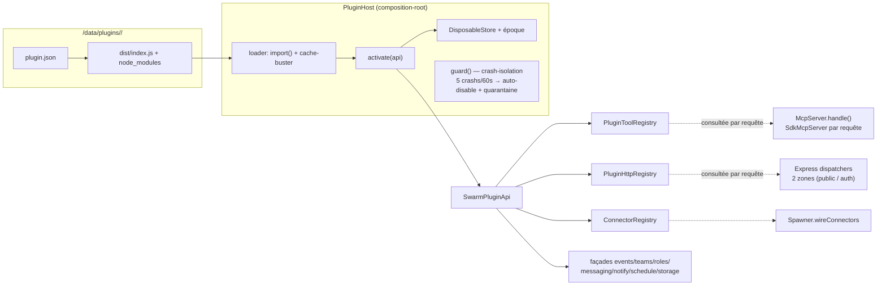
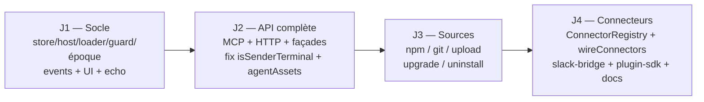

# Système de plugins installables pour swarm-os

## Contexte

swarm-os est un monolithe câblé à la main : chaque module est instancié dans `packages/server/src/index.ts` et branché manuellement. Les seules abstractions quasi-pluggables (`Notifier`, `Connector` figé à `'discord'`, `eventBus` à union fermée, outils MCP codés en dur dans `registerTeamCommsTools`) ne sont extensibles que par édition du code source. Objectif : un vrai système de plugins **installables** donnant aux plugins un accès maximal à swarm-os — messagerie/mailboxes, rôles, équipes, bus d'événements, outils MCP exposés aux agents, routes HTTP, connecteurs de canaux type Discord (Slack/Telegram…), scheduling, stockage.

**Décisions produit validées par l'utilisateur** :
1. Sources d'installation multiples : `/data/plugins` + UI, npm, git ; architecture prête pour un marketplace interne.
2. **In-process, API complète** — plugins = code de confiance (instance single-user auto-hébergée).
3. UI générique pilotée par manifeste (pas de bundles front tiers).
4. **Chargement à chaud** — install/enable/disable/uninstall sans redémarrage ni interruption des équipes (24/7).

**Vérification du plan contre le code (session de planification)** — tous les points d'ancrage confirmés :
- `uncaughtException` FATAL : `index.ts:341-359` (shutdown + exit 1) → `guard()` obligatoire sur tout callback plugin.
- `SdkMcpServer` recréé **par requête**, `registerTeamCommsTools(sdkServer, () => ctx)` à `mcp/server.ts:218-222` → hook +1 ligne, zéro invalidation.
- `mcp.json` par session : un seul serveur `team-comms` (`orchestrator/mcp-config.ts:59-78`) → plugins couverts sans modification.
- `isSenderTerminal` (`orchestrator/mailbox-persistence.ts:229-249`) n'exempte que `'system'`/`'human'` → un `from='plugin:x'` pending serait détruit au boot (fix B1 requis).
- Ordre des middlewares `http/main.ts` : **express.json(:99 — global, seul body-parser du serveur, limite ≈128 Ko)** → hooks(127) → static(149) → ideProxy(185) → **bootGate(193-204)** → **auth(208)** → routers → les 2 zones plugin s'insèrent exactement là. Conséquences : capture `rawBody` requise pour les webhooks publics (B-1) et `express.raw` scoped requis pour l'upload — aucun parser raw n'existe aujourd'hui.
- `startServer` thread déjà `onRolesChanged` = `() => scheduler.reload()` (`index.ts:222`, `main.ts:89`) → même callback injecté dans `PluginHostDeps`.
- `parseConnectors` rejette tout type ≠ `'discord'` (`http/routes/roles.ts:105`) ; `OrchSubscription` (`discord/bot.ts:76-88`) expose déjà `getLeadSessionId`/mailbox/`notifyLead` → généralisation directe. Méthodes : `DiscordBotPool.subscribeOrch` (`pool.ts:37`) côté pool ; `subscribeOrchestrator` est sur `DiscordBotService` (`bot.ts:184`). ⚠️ `GET/PUT /roles` renvoie aujourd'hui le `botToken` en clair (`roles/index.ts:102-125`, `routes/roles.ts:182,259,361` ; pré-rempli `RolesPage.tsx:891`) — corrigé en J4 avec le masque-sentinelle des connecteurs.
- `SwarmDb.db` public (`db/index.ts:176`) ; `INLINE_SCHEMA` est le **fallback** d'`applySchema` (`db/index.ts:502-513` — `readFileSync(schema.sql)` d'abord, fallback au catch ; définition :946), fallback qui devient le chemin effectif en image Docker (tsc ne copie pas les .sql) ; `BackupScheduler` illustre l'accès au Db brut (`backup/index.ts:33-34`) mais ne prépare aucun statement (il appelle `db.backup()`) — le modèle « statements préparés » est `SwarmDb` lui-même → le PluginStore crée ses tables ET prépare ses statements lui-même.
- `resumeFromDb` : `spawner/index.ts:375`, try/catch par orch + `wireDiscordBot` par orch (~436-447) — miroir pour `activateEnabled()`.
- `wireDiscordBot` : `spawner/index.ts:84` ; `requireLead` : `mcp/tools.ts:139` ; `ok()` : `mcp/tools.ts` (~123).
- `ensureDir` : `config.ts:304`, appelé sur dataDir à `config.ts:443`.
- Dockerfile runtime : git ✓ (:109), npm ✓ (installé, :146), `USER node` (:151) → jamais `npm install -g` pour les plugins.
- `events.ts` : union fermée `SwarmEventKind` (7 kinds) ; `EventsHub` rebroadcast sans filtrage ; front à `if` indépendants (pas de switch exhaustif) ; `deriveKind` dans `web/src/components/desktop/pulses.ts:29`.
- Web : `RolesPage.tsx` = modèle de la PluginsPage ; `TopBar.tsx`, `mobile/MobileShell.tsx`, `App.tsx`, `api/client.ts`, `hooks/useEvents.ts` présents comme attendu.

Le plan a en outre été passé au crible par 3 validations adversariales (runtime Docker, intégration serveur, red-team cycle de vie) ; les correctifs sont intégrés et marqués ⚠️.

## Architecture retenue

**Plugins in-process, ESM JS pur, chargés à chaud depuis `/data/plugins/<name>/`, pilotés par un `PluginHost` unique dans le composition-root, API injectée (`SwarmPluginApi`), teardown automatique par disposables.**



Principes clés :
- **API injectée, jamais d'import des internals** : le plugin reçoit un objet `api` encapsulant Spawner/RoleStore/messaging/eventBus. Son code vit hors de l'arbre `node_modules` du serveur donc il ne *peut pas* résoudre les modules du serveur — contrainte transformée en règle d'architecture.
- **Indirections dynamiques, jamais de démontage** : Express ne démonte pas un router, le `SdkMcpServer` est recréé **par requête** (vérifié : zéro invalidation à gérer), l'EventEmitter garde ses listeners. Solution unique : des **registries mutables consultées au moment de la requête/de l'événement**. Enable/disable = mutation de Map.
- **Chargement natif `import()`** avec cache-buster `?v=<version>-<Date.now()>` (zéro dep ; les plugins TS pré-compilent, `manifest.main` pointe un `.js`). Fuite bornée du cache ESM assumée et documentée.
- **Une seule surface MCP** : les outils de plugin s'enregistrent dans le serveur `team-comms` existant → le `mcp.json` par session et `--strict-mcp-config` couvrent les plugins **sans modification**.
- ⚠️ **Crash-isolation obligatoire à toutes les frontières** : `uncaughtException` est FATAL dans ce serveur. Un throw dans un timer/EventEmitter d'un plugin non guardé tuerait le serveur. D'où : tout callback plugin (events, cron, interval, routes, outils MCP, connecteurs) passe par le wrapper `guard()` du host — structurel, pas cosmétique.

## Persistance

⚠️ **Le `PluginStore` crée ses propres tables** via `CREATE TABLE IF NOT EXISTS` sur le `Database` brut (`SwarmDb.db`, champ public) à sa construction, et prépare ses propres statements (modèle `SwarmDb`). On ne touche NI `schema.sql` NI `INLINE_SCHEMA` (`INLINE_SCHEMA` est le fallback d'`applySchema` qui devient le chemin **effectif** en image Docker — tsc ne copie pas les .sql — la double source est un piège).

```sql
CREATE TABLE IF NOT EXISTS plugins (
  name          TEXT PRIMARY KEY,          -- ^[a-z][a-z0-9-]{1,40}$
  version       TEXT NOT NULL,
  source_kind   TEXT NOT NULL,             -- 'dir' | 'upload' | 'npm' | 'git' (+ 'registry' réservé)
  source_ref    TEXT,
  enabled       INTEGER NOT NULL DEFAULT 0,
  config_json   TEXT,
  granted_capabilities_json TEXT,            -- autorisations accordées par l'opérateur dans l'UI (⊆ manifest.capabilities)
  api_version   INTEGER NOT NULL DEFAULT 1,
  fail_count    INTEGER NOT NULL DEFAULT 0,   -- ⚠️ quarantaine durable (red-team I2)
  quarantined_until TEXT,                      -- backoff exponentiel ; sauté au boot si dans le futur
  installed_at  TEXT NOT NULL,
  updated_at    TEXT NOT NULL,
  last_error    TEXT
);
CREATE TABLE IF NOT EXISTS plugin_kv (
  plugin TEXT NOT NULL, key TEXT NOT NULL, value TEXT, updated_at TEXT NOT NULL,
  PRIMARY KEY (plugin, key)
);
```

Arborescence disque (⚠️ `/data/plugins` créé au boot via le pattern `ensureDir` de `config.ts:304` ; dépend du bind-mount hôte appartenant à uid 1000 — déjà le cas des compose existants) :
```
/data/plugins/
  .staging/<uuid>/          # zone de travail install — SOUS dataDir (même FS ⇒ rename atomique), purgée au boot
  <name>/
    plugin.json             # manifeste
    package.json            # optionnel (deps)
    node_modules/           # deps npm propres au plugin (résolution ESM Node standard)
    dist/index.js           # entrée ESM (manifest.main)
```

## Format d'un plugin

**Langage** : JavaScript ESM (ou TypeScript pré-compilé en JS avant packaging) — le plugin tourne dans le process serveur Node.js. Pas de modules natifs (pas de toolchain dans l'image). Un plugin peut lancer des sous-process (`child_process` — python3/bash/etc. si présents dans le container) et livrer des scripts multi-langages aux agents via `agentAssets` (exécutés dans l'environnement des agents).

### Manifeste `plugin.json` (validé zod — `modules/plugins/manifest.ts`)

```ts
export const HOST_API_VERSION = 1;
export interface PluginManifest {
  name: string;              // ^[a-z][a-z0-9-]{1,40}$ — préfixe routes/outils/events
  version: string;           // semver
  displayName?: string; description?: string;
  main: string;              // entrée ESM .js relative (ex. "dist/index.js")
  apiVersion: number;        // refus d'enable si > HOST_API_VERSION
  capabilities: PluginCapability[];   // déclaratif : affiché UI + gate les façades api.*
  configSchema?: PluginConfigSchema;  // subset JSON Schema (formulaire UI généré)
  agentAssets?: { dir: string };      // scripts/CLI mis à disposition des agents (voir section dédiée)
  connectors?: Array<{ type: string; label: string; schema: PluginConfigSchema }>; // J4
  uiPanels?: UiPanelDecl[];  // réservé v2
}
export type PluginCapability =
  | 'events' | 'events-emit' | 'messaging' | 'teams' | 'roles'
  | 'mcp-tools' | 'http-routes' | 'http-public' | 'agent-assets'
  | 'db-kv' | 'db-tables' | 'notify' | 'schedule' | 'connectors' | 'settings-read';
```

**Autorisations accordées par l'opérateur** : le manifeste *déclare* les capacités demandées ; c'est la page de gestion qui les *accorde*. Au premier enable, un dialogue liste les capacités demandées (cases cochées par défaut, décochables) ; le choix est persisté (`granted_capabilities_json`) et modifiable à tout moment depuis la fiche du plugin (modification → hot-restart du plugin). `buildPluginApi` ne matérialise que **manifest ∩ accordées** ; un accès non accordé échoue avec une erreur claire. Un upgrade qui demande de nouvelles capacités les présente pour approbation avant ré-activation. **Pas un sandbox** — garde-fou déclaratif, modèle de confiance assumé et documenté.

Noms réservés refusés à l'install : `team`, `swarm`, `discord`, `plugins`, `api`, `ws`, `health`, `info`, `ide`, `hooks`, `metrics`, `orchestrators`, `sessions`, `roles`, `settings`, `backup`, `preambles`.

### Point d'entrée

```ts
export interface SwarmPlugin {
  activate(api: SwarmPluginApi): void | Promise<void>;
  deactivate?(): void | Promise<void>;   // optionnel — les disposables couvrent le reste
}
// export default { activate, deactivate } satisfies SwarmPlugin
```

### Dépendances npm du plugin

`import(pathToFileURL('/data/plugins/<name>/dist/index.js'))` : la résolution ESM remonte les `node_modules` depuis le fichier importé → chaque plugin embarque ses deps. Installées par `npm install --omit=dev --no-audit --no-fund --ignore-scripts`. ⚠️ Validé sur l'image runtime : npm ✓, git ✓, tar ✓ ; **jamais `npm install -g`** (prefix global root-owned sous `USER node`) ; passer explicitement `HOME=/home/node` et `npm_config_cache` dans l'env d'`execFile`. Pas de deps natives (pas de toolchain — un require natif échoue à l'activate, erreur propre dans `last_error`). **zod** : les schémas MCP doivent utiliser l'instance du serveur → `api.zod` (zod **v4**, `^4.4.3` — API différente de v3, à préciser dans docs/plugins.md).

## Interfaces clés (`modules/plugins/api-types.ts`)

```ts
export interface Disposable { dispose(): void }
export class DisposableStore { add<T extends Disposable>(d: T): T; disposeAll(): void } // ordre inverse, try/catch loggé

export interface SwarmPluginApi {
  readonly pluginName: string;
  readonly log: Logger;                          // withModule(`plugin.${name}`)
  readonly zod: typeof z;
  readonly config: {
    get<T = Record<string, unknown>>(): T;
    onChange(cb: (next: unknown) => void): Disposable;  // sinon : host.reload(name) au PUT config
  };
  readonly storage: {
    kv: { get(k: string): string | null; set(k: string, v: string): void; delete(k: string): void;
          list(prefix?: string): Array<{ key: string; value: string }> };
    defineTable(ddl: string): void;              // ⚠️ .prepare() mono-statement (pas .exec), préfixe plugin_<name'>_ vérifié
                                                 // où name' = name avec '-'→'_' (tiret nu = identifiant SQL invalide :
                                                 // CREATE TABLE plugin_slack-bridge_x est une syntax error SQLite),
                                                 // ATTACH refusé — garde anti-accident, PAS une frontière (documenté)
    prepare<P extends object = object, R = unknown>(sql: string): { run(p?: P): void; get(p?: P): R | undefined; all(p?: P): R[] };
  };
  readonly events: {                             // ⚠️ FAÇADE, jamais le bus brut (red-team B2)
    on(kind: SwarmEventKind | '*', cb: (ev: SwarmEvent) => void): Disposable;
        // handlers dispatchés en asynchrone (setImmediate) — hors du chemin synchrone
        // emitEvent → sendMessage ; wrappés par guard() ; retirés au disable
    emit(subKind: string, payload?: unknown, opts?: { orchestratorId?: string; sessionId?: string }): void;
        // kind forcé `plugin.${pluginName}.${subKind}` — impossible de forger un kind core
  };
  readonly teams: {   // façade Spawner + Orchestrator — snapshots, jamais session_secret
                      // create → Spawner.create(spec, opts) = { orchestrator, lead } (spawner/index.ts:134,31) ;
                      // spawnWorker/killWorker n'existent PAS sur le Spawner : spawner.get(orchId) puis
                      // Orchestrator.addWorker (orchestrator/index.ts:550) / Orchestrator.killWorker (:697)
    list(): TeamView[]; get(id: string): TeamView | null;
    create(spec: { name: string; roleId?: string; cwd: string; prompt?: string }): Promise<{ id: string; leadSessionId: string }>;
    destroy(id: string, reason?: string): Promise<void>;
    spawnWorker(orchId: string, spec: { name: string; role?: string; prompt: string; cwd?: string }): Promise<{ sessionId: string }>;
    killWorker(orchId: string, sessionId: string): Promise<void>;
  };
  readonly roles: {   // façade RoleStore ; ⚠️ mutations → onRolesChanged() injecté dans PluginHostDeps
    list(): Role[]; get(id: string): Role | null;    //    (= () => scheduler.reload(), même callback que startServer, index.ts:222)
    create(init: RoleInit): Role; update(id: string, patch: RolePatch): Role; delete(id: string): void;
  };
  readonly messaging: {   // from = `plugin:<name>` (accepté : from non contraint, messaging.ts:182)
    // ⚠️ sendToSession/broadcast wrappent sendMessage (:182) / broadcast (:247) — fromSid libre, OK tels quels.
    // sendToLead/broadcastToLeads ne peuvent PAS wrapper sendMessageToLead (:336) / broadcastToLeads (:433) :
    // ces helpers exigent un sourceOrch/sourceSid réels qu'un plugin n'a pas. La façade emprunte le chemin
    // du bridge Discord : mailbox.push + emitMailboxMessage + réveil idle (= pushToLeadInbox).
    sendToSession(orchId: string, sessionId: string, content: string): SendOutcome;
    sendToLead(orchId: string, content: string): CrossSendOutcome;
    broadcast(orchId: string, content: string): BroadcastOutcome;
    broadcastToLeads(content: string): CrossBroadcastOutcome;
    readInbox(orchId: string, sessionId: string): Message[];   // destructif — réservé aux bridges
  };
  readonly mcp: { registerTool(def: PluginToolDef): Disposable };          // exposé `<name>.<tool>` aux agents
  readonly http: {
    registerRouter(router: express.Router): Disposable;        // /plugin-api/<name>/* — APRÈS bootGate + auth
    registerPublicRouter(router: express.Router): Disposable;  // /public/plugins/<name>/* — APRÈS bootGate, AVANT auth
  };
  readonly notify: { send(input: NotificationInput): Promise<void> };   // wrappe Notifier.notify() (notify/index.ts:56 — la méthode s'appelle notify, pas send) ; singleton spawner.notifier
  readonly schedule: {
    cron(expr: string, cb: () => void | Promise<void>): Disposable;   // croner, TZ = config.scheduleTimezone, cb guardé
    interval(ms: number, cb: () => void): Disposable;                 // setInterval traqué + unref, cb guardé
  };
  readonly connectors: { register(type: string, provider: ChannelConnectorProvider): Disposable }; // J4
  readonly settings: { instance(): InstanceSettings };  // lecture seule
}

export interface PluginToolDef {
  name: string; title: string; description: string;
  leadOnly?: boolean;                 // garde requireLead (mcp/tools.ts:139) appliquée par le wrapper hôte
  inputSchema: ZodRawShape;           // construit avec api.zod
  outputSchema?: ZodRawShape;
  handler(args: Record<string, unknown>, ctx: PluginToolContext): Promise<object> | object;
}
export interface PluginToolContext {  // ⚠️ PROJECTION du ToolContext — le vrai ctx expose Orchestrator/Session/Spawner/Config
  orchestratorId: string; orchestratorName: string;      // complets ; le plugin ne reçoit que ceci, jamais session_secret
  sessionId: string; sessionName: string; role: string; isLead: boolean;
}

export interface ChannelConnectorProvider {   // généralisation de DiscordBotPool/OrchSubscription (discord/bot.ts)
  subscribeOrch(connectorConfig: Record<string, unknown>, sub: PluginOrchSubscription): Promise<void>;
  unsubscribeOrch(orchId: string): Promise<void>;
  stopAll(): Promise<void>;
}
export interface PluginOrchSubscription {
  orchestratorId: string;
  getLeadSessionId(): string | null;
  pushToLeadInbox(content: string, meta?: { from?: string; sourceKind?: string; sourceMessageId?: string; threadId?: string }): void;
  notifyLead(): void;    // réveil PTY si idle — même chemin que le bot Discord
}

export interface PluginView {                 // retourné par tous les endpoints REST et PluginHost.list()
  name: string; version: string; displayName?: string;
  status: PluginRuntimeStatus; enabled: boolean;
  sourceKind: string; apiVersion: number;
  capabilities: PluginCapability[];           // demandées (manifeste)
  grantedCapabilities: string[] | null;       // accordées (opérateur)
  failCount: number; quarantinedUntil: string | null;
  lastError: string | null; installedAt: string; updatedAt: string;
}
```

Toutes les méthodes `on*/register*/cron/interval` retournent un `Disposable` **et** sont auto-ajoutées au `DisposableStore` du plugin. ⚠️ Chaque façade porte un **jeton d'époque** capturé à l'activate : un appel à époque périmée (tick asynchrone encore en vol après `disable()`) lève une **`PluginDisabledError`** bénigne — PAS un no-op silencieux : les méthodes à valeur de retour (`kv.get`, `teams.list`, `sendToSession`…) renverraient sinon `undefined` et feraient crasher le code du plugin. `guard()` avale `PluginDisabledError` **sans** l'imputer au compteur de crashs (red-team I3).

Utilitaire à écrire : `withTimeout(promise, ms)` générique (celui de `discord/portal.ts` est local et spécialisé fetch).

## PluginHost (`modules/plugins/host.ts`)

```ts
export type PluginRuntimeStatus = 'disabled' | 'enabled' | 'error' | 'crashed' | 'quarantined';
export class PluginHost {
  async activateEnabled(): Promise<void>;   // boot — voir ci-dessous
  async enable(name: string): Promise<PluginView>;
  async disable(name: string): Promise<PluginView>;
  async reload(name: string): Promise<PluginView>;
  async deactivateAll(): Promise<void>;
  list(): PluginView[];
  guard(name, hook, fn): (...a) => void | Promise<void>;    // crash-isolation de TOUS les callbacks plugin, sync ET async
}
```

- **enable()** : re-valider `plugin.json` (zod, apiVersion ≤ HOST_API_VERSION) → `import(url + cache-buster)` → valider `mod.default` → `buildPluginApi(deps, name, disposables, epoch)` → `withTimeout(activate(api), 10_000)`. Échec : `disposeAll()` (activate partiel), `status='error'`, `last_error`, `fail_count++` + `quarantined_until` (backoff), HTTP 422, enabled reste 0. Succès : `enabled=1`, `fail_count=0`, event `plugin.host.changed`.
- **disable()** : incrément d'époque (les ticks en vol deviennent no-op) → `withTimeout(deactivate?.(), 5_000)` (échec = log) → `disposeAll()` → retrait des registries → `enabled=0` → event. Registries consultées à chaud ⇒ disable complet et instantané.
- **reload()/upgrade** : ⚠️ enregistrer le nouveau set d'outils MCP **avant** de retirer l'ancien (swap dans la registry) pour minimiser la fenêtre « unknown tool » vue par un agent en plein travail (red-team I4) ; fenêtre résiduelle documentée.
- **Crash isolation** : `guard()` enveloppe tout callback, **sync ET async** — il détecte un thenable retourné et `.catch()` le rejet, sinon un handler async qui rejette finirait en `unhandledRejection` (log-only, `index.ts:360-368`) et **contournerait entièrement la quarantaine** (or les handlers async sont le cas le plus courant). Throws sync et rejets async alimentent le même compteur/`last_error` ; `PluginDisabledError` (époque) est avalée sans compter. ≥5 crashs/60 s → auto-disable runtime (`status='crashed'`, `last_error`, notification) **+ ⚠️ quarantaine persistée** (`fail_count`, `quarantined_until` backoff exponentiel) — au boot, les plugins en quarantaine active sont sautés au lieu d'être ré-armés en boucle (red-team I2).
- **⚠️ activateEnabled()** : chaque plugin dans son propre try/catch **y compris l'`import()`** (une SyntaxError d'un fichier corrompu après un swap interrompu ne doit jamais empêcher `runAutoResume` / le flip du bootGate) — miroir exact de `resumeFromDb` (`spawner/index.ts:375`, wiring par orch ~436-447) (red-team I5).
- **Sérialisation** : promesse-verrou par nom **partagé entre PluginHost ET PluginInstaller** (enable/disable/reload/upgrade/swap-installer jamais concurrents sur le même nom — sans verrou commun, un enable concurrent d'un upgrade peut `import()` un arbre à moitié swappé, TOCTOU red-team I-8).

### Intégration au boot (`src/index.ts`)

```ts
const pluginStore = new PluginStore(db);            // crée ses tables (CREATE TABLE IF NOT EXISTS)
const pluginToolRegistry = new PluginToolRegistry();
const pluginHttpRegistry = new PluginHttpRegistry();
const connectorRegistry = new ConnectorRegistry();  // J4 — provider 'discord' built-in
const pluginHost = new PluginHost({ ..., onRolesChanged: () => scheduler.reload() });
const pluginInstaller = new PluginInstaller({ pluginsDir: join(config.dataDir, 'plugins'), store: pluginStore });
const mcp = new McpServer(spawner, config.mcpPort, config, busMetrics, pluginToolRegistry);  // 5e param optionnel
mcp.start()
   .then(() => pluginHost.activateEnabled())   // AVANT auto-resume : bridges up quand les équipes reviennent
   .then(() => runAutoResume());               // (chaîne existante index.ts:275-277)
// ⚠️ activateEnabled() ne rejette JAMAIS (catch interne par plugin) : le .catch existant de la chaîne
// (index.ts:278-288) est FATAL (close handle + shutdown + exit 1) et ne doit pas être déclenché par un plugin.
```
Shutdown (`index.ts:296-325`) : `await pluginHost.deactivateAll()` après `scheduler.stop()` (:308), avant `spawner.shutdownAll(...)` (:311).

## Ouverture des points d'extension

1. **`SwarmEventKind`** (`src/events.ts`) : `type SwarmEventKind = BuiltinSwarmEventKind | \`plugin.${string}\``, + kind built-in `plugin.host.changed` (payload minimal `{ name, status, enabled }` — permet à l'UI de patcher une row sans refetch). `EventsHub` rebroadcast déjà tout sans filtrage (vérifié) et le front ignore proprement les kinds inconnus (vérifié : `if` indépendants dans `useEvents.ts`, pas de switch exhaustif). ⚠️ Les messages `from='plugin:<name>'` ne cassent pas l'UI (classés `'intra'` par `deriveKind`, `pulses.ts:29-45` ; position introuvable → pulse ignoré, `MapView.tsx:292`) mais pour les rendre visibles : dans `deriveKind`, retourner un kind non-`intra` pour `plugin:*` — le mapping existant `→ '__center__'` (`SwarmController.tsx:362`) s'applique alors.

2. **Outils MCP dynamiques** (`modules/plugins/mcp-registry.ts`) : `PluginToolRegistry.registerAll(sdkServer, ctxResolver)` appelé dans `McpServer.handle()` juste après `registerTeamCommsTools` (`mcp/server.ts:222`, +1 ligne). Le wrapper : `requireLead` si `leadOnly`, projection `ToolContext` → `PluginToolContext`, enveloppe `ok()` (mcp/tools.ts), guard (erreur plugin → réponse MCP propre).

3. **Routes HTTP dynamiques** (`modules/plugins/http-registry.ts`) : jamais de démontage — dispatchers consultant une `Map<name, Router>` :
   - ⚠️ Pas de précédent de mount path paramétré dans le repo (et path-to-regexp v8 a changé la syntaxe) → utiliser le pattern éprouvé : un `Router({ mergeParams: true })` interne avec `router.use('/plugin-api/:name', dispatcher)`.
   - Ordre explicite (red-team M5) : zone `public` = `/public/plugins/:name/*` montée **après bootGate (main.ts:193-204), avant auth (main.ts:208)** (webhooks entrants — le plugin vérifie ses signatures) ; zone `auth` = `/plugin-api/:name/*` montée **après auth**. Préfixe distinct de `/plugins` (REST de gestion) = zéro ambiguïté.
   - ⚠️ **Raw body (B-1 — bloquant webhooks)** : `express.json` global (`main.ts:99`) consomme le flux JSON en amont de la zone publique, or les signatures HMAC (Slack/Stripe/GitHub) se calculent sur les **octets bruts**. Correctif : `express.json({ limit, verify: (req,_res,buf) => { req.rawBody = buf } })` et exposer `req.rawBody` aux handlers publics (documenter dans docs/plugins.md). Cas annexe documenté : les bodies `x-www-form-urlencoded` ne sont pas parsés du tout (aucun parser) — flux intact, `req.body` undefined.
   - `dispose()` ⇒ `Map.delete` ⇒ 404 immédiat. Erreur handler → 500 JSON `{ error: 'PLUGIN_ERROR', plugin }` + crash counter.

4. **`ConnectorType`** (J4, `modules/roles/index.ts`) : `'discord' | (string & {})` + `GenericConnector`. `ConnectorRegistry` avec provider `discord` built-in wrappant `DiscordBotPool.subscribeOrch` (`pool.ts:37` — `subscribeOrchestrator` est la méthode interne de `DiscordBotService`, `bot.ts:184`). `Spawner.wireDiscordBot` (`spawner/index.ts:84`) généralisé en `wireConnectors(orch, role)` ; destroy/hide/shutdown → `unsubscribeOrch`. `pushToLeadInbox` réutilise `mailbox.push` + `emitMailboxMessage` + réveil idle. ⚠️ `parseConnectors` (`http/routes/roles.ts:94-107`) rejette aujourd'hui tout type ≠ 'discord' → whitelist dynamique alimentée par la registry (type inconnu sans provider = 422 `UNKNOWN_CONNECTOR_TYPE`). ⚠️ **Câblage rétroactif** (red-team I1) : `connectors.register` itère `spawner.list()` et câble chaque orch vivant dont le rôle porte ce type ; le provider tient l'inventaire de ses souscriptions pour tout défaire au `dispose()`/`stopAll()`. ⚠️ **Secrets connecteurs (red-team I-4)** : `GET/PUT /roles` renvoie aujourd'hui le `botToken` Discord **en clair** (`roles/index.ts:102-125`, `routes/roles.ts:182,259,361` ; `RolesPage.tsx:891` pré-remplit l'input avec) — appliquer le masque-sentinelle `format:'password'` (même mécanique que la config plugin) au sérialiseur roles + préservation au PUT dans `parseConnectors`, piloté par le `schema` déclaré du connecteur ; corrige au passage la fuite `botToken` préexistante.

5. **⚠️ Persistance mailbox** (red-team B1 — bloquant) : `isSenderTerminal` (`modules/orchestrator/mailbox-persistence.ts:229-249`) n'exempte que `'system'`/`'human'` → tout message pending `from='plugin:x'` serait **silencieusement détruit à chaque boot** (classé sender-terminal ligne 243-246 : session inconnue = terminal). Correctif : exempter le préfixe `plugin:` au même titre que system/human (ligne 234). À livrer avec la façade messaging (J2).

## Installation (`modules/plugins/installer.ts`)

**Pipeline commun** : staging `/data/plugins/.staging/<uuid>` (⚠️ toujours sous dataDir ; asserter même device que `pluginsDir` avant rename, fallback copy — red-team M3) → `npm install --omit=dev --no-audit --no-fund --ignore-scripts` si deps (`execFile('npm', ...)`, timeout 180 s, ⚠️ env explicite `HOME`/`npm_config_cache`, jamais `-g`) → `loadManifest()` + checks (regex nom, apiVersion, noms réservés, anti path-traversal sur `main`) → swap `fs.rename` (upgrade : disable → swap → re-enable) → upsert row → event. Purge `.staging/*` au boot. Un crash entre disable et rename est bénin (ancien code en place, ré-enable au boot). ⚠️ Toute mutation installer (install/upgrade/uninstall/swap) s'exécute **sous le même verrou par nom que le PluginHost** (red-team I-8).

Par source :
- **dossier/upload** : `.tgz` format `npm pack` — ⚠️ body brut via `express.raw({ type: ['application/gzip','application/octet-stream'], limit: '50mb' })` monté **sur la seule route upload** (aucun parser raw n'existe dans le serveur ; `express.json` ignore les types non-json → personne ne lirait le flux, et sa limite ≈128 Ko n'est pas le bon cap) ; mapper `entity.too.large` → 413 via l'error handler (`main.ts:234`) ; puis `tar -xzf --strip-components=1` ; `POST /plugins/scan` pour le drop manuel — le scan marque aussi `error`/`enabled=0` les rows dont le dossier a disparu (sans les supprimer : préserve la config pour un re-drop).
- **npm** : ⚠️ PAS de `npm install --prefix <staging> <spec>` + déplacement du dossier (bloquant B-2 : npm hoiste les deps du paquet en **siblings** dans `<staging>/node_modules/` — le dossier déplacé perd ses deps, la résolution ESM échoue, tout plugin npm avec deps runtime meurt à l'activate). À la place : `npm pack <spec>` en staging → produit un `.tgz` au format exact du pipeline upload → même chemin (extract + `npm install --omit=dev …` **dans** le dossier du plugin).
- **git** : `git clone --depth 1 [--branch ref] url staging` (git présent dans l'image runtime), suppression `.git`. Le dépôt committe le JS compilé (pas de build à l'install).
- **marketplace** : `source_kind='registry'` + `GET /plugins/catalog` réservés ; l'installer est déjà structuré `fetch → stage → validate → swap`.

**Uninstall** (`DELETE /plugins/:name`, red-team I-9) : sous verrou — `if enabled: await host.disable()` (époque + disposables + registries) → suppression du dossier `agentAssets` → `fs.rm` du dossier plugin → drop row. `?purge=true` supprime aussi `plugin_kv`, la config **et toutes les tables/index/triggers `plugin_<name'>_%`** (énumération `sqlite_master`, même transaction — sinon une réinstallation du même nom hérite silencieusement des vieilles données, red-team I-6). **Upgrade par source** : `npm`/`git` re-fetchent `source_ref` ; `dir` re-scanne le dossier ; `upload` → 409 « nécessite un nouvel upload ».

## REST + UI

### Endpoints (`http/routes/plugins.ts`, monté après auth)

```
GET    /plugins                     → { plugins: PluginView[] }
GET    /plugins/:name               → { plugin: PluginView } (+ manifest complet)
POST   /plugins/install             { source:'npm', spec } | { source:'git', url, ref? } | { source:'dir', dir }
POST   /plugins/upload?name=x       body .tgz (application/gzip — express.raw scoped, cap 50 Mo)
POST   /plugins/scan
POST   /plugins/:name/enable        { grantedCapabilities?: string[] } → 200 | 422 { error, last_error }
POST   /plugins/:name/disable
PUT    /plugins/:name/permissions   { grantedCapabilities: string[] }  → hot-restart si activé
POST   /plugins/:name/upgrade
PUT    /plugins/:name/config        → validation vs configSchema → onChange ou host.reload(name)
DELETE /plugins/:name?purge=true    (disable d'abord si actif ; purge = drop plugin_kv + config + tables plugin_<name'>_*)
```

### Config générée depuis le manifeste

Subset JSON Schema (validateur maison ~100 lignes, `modules/plugins/config-schema.ts`) : `type: object`, props `string | number | boolean | enum`, `required`, `default`, `title`, `description`, `format: 'password'` (GET renvoie une sentinelle `'•••'` ; un PUT renvoyant la sentinelle conserve l'ancienne valeur — tokens Slack/Telegram). Pino redaction sur `config_json` (ajout à `REDACT_PATHS`, `logger.ts:36-70`).

### Front

- `App.tsx` : `| { kind: 'plugins' }`, parse `#/plugins`, overlay `<PluginsPage>` (calqué sur `RolesPage.tsx`).
- `SwarmController.tsx` : prop `onOpenPlugins` (miroir de `onOpenRoles`) ; boutons dans `desktop/TopBar.tsx` et `mobile/MobileShell.tsx`.
- Nouveaux : `components/PluginsPage.tsx` (liste, badges statut/erreur/quarantaine, toggle activer/désactiver, désinstaller, config, install), `components/plugins/InstallPluginModal.tsx` (onglets npm/git/upload), `components/plugins/PluginConfigForm.tsx`, `components/plugins/PermissionsDialog.tsx` (accord des capacités au premier enable + édition depuis la fiche plugin).
- `api/client.ts` : méthodes list/get/install/upload/scan/enable/disable/upgrade/setConfig/setPermissions/uninstall.
- `hooks/useEvents.ts` : `onPluginHostChanged` (refresh live). Panneaux `uiPanels` : réservés v2.

## Scripts/CLI pour les agents (`agentAssets`) — décision utilisateur

Un plugin peut livrer des scripts exécutés **par les agents eux-mêmes** (via Bash dans leur session), en plus des outils MCP :
- Le manifeste déclare `agentAssets: { dir: "agent" }` (capability `agent-assets`) — un dossier du package contenant scripts/CLI (bash, node, python…).
- À l'**enable**, le host copie récursivement ce dossier vers `<workspaceRoot>/.swarm-plugins/<name>/` en préservant les modes d'exécution (chmod +x) ; au **disable/uninstall**, le dossier est supprimé. Le chemin workspace vient de `config.workspaceRoot` (même racine que la validation de cwd de `http/validation.ts`).
- Transport SSH : le workspace étant bind-monté, les fichiers écrits par le serveur sont visibles des agents hôte (cwd traduit container→hôte via `toHostPath`, `orchestrator/session.ts:1330-1334`, `hostWorkspaceRoot` `config.ts:225`) — aucune mécanique nouvelle ; uid 1000 aligné des deux côtés (`USER node`).
- ⚠️ **Chemins (red-team I-5)** : le relatif `.swarm-plugins/<name>/` ne résout que si le cwd de l'agent EST la racine workspace — or les équipes sont couramment créées avec un cwd sous-dossier (`/workspace/<projet>`), et un chemin absolu diffère par transport (`/workspace/...` local vs `${hostWorkspaceRoot}/...` SSH). L'API expose donc un chemin de base **côté agent**, résolu transport-aware par le host (ex. `api.agentAssets.basePath`), que le plugin utilise dans ses annonces.
- Découvrabilité : responsabilité du plugin — annoncer ses scripts aux leads via `api.messaging.broadcastToLeads` à l'activate (avec le basePath ci-dessus), et/ou exposer un outil MCP `<name>.help`. Pas d'injection de préambule/skills (option explicitement écartée par l'utilisateur).
- Contrainte documentée : les interpréteurs requis doivent exister dans l'environnement des agents (bash/node présents ; python selon l'image/hôte).

## Exposition MCP aux agents — vérifié

`mcp.json` par session pointe le serveur `team-comms` unique (`mcp-config.ts:59-78`) → **aucun changement**. Sessions lancées après enable : outils visibles immédiatement. Sessions déjà lancées : transport stateless → pas de `tools/list_changed` ; outils visibles au prochain restart/resume de session. Mitigation (J2) : message informatif aux leads via `broadcastToLeads` au changement de tool set. Invariants : loopback 8788, jamais `session_secret` côté plugin, `leadOnly` = `requireLead` existant.

## Fichiers à créer / modifier

**Créer — serveur** (`packages/server/src/`) :

| Fichier | Contenu |
|---|---|
| `modules/plugins/api-types.ts` | `SwarmPlugin`, `SwarmPluginApi`, `Disposable(Store)`, `PluginToolDef/Context`, `ChannelConnectorProvider` |
| `modules/plugins/manifest.ts` | manifeste zod, `loadManifest`, `HOST_API_VERSION`, noms réservés |
| `modules/plugins/store.ts` | `PluginStore` (CREATE TABLE IF NOT EXISTS + statements + kv + quarantaine) |
| `modules/plugins/host.ts` | `PluginHost` (enable/disable/reload/activateEnabled/deactivateAll/guard/époque/quarantaine) |
| `modules/plugins/api.ts` | `buildPluginApi(deps, name, disposables, epoch)` |
| `modules/plugins/loader.ts` | import ESM + cache-buster + validation export |
| `modules/plugins/installer.ts` | pipelines dir/upload/npm/git, staging, swap, scan, uninstall |
| `modules/plugins/mcp-registry.ts` | `PluginToolRegistry` + wrapper ok()/requireLead/projection/guard |
| `modules/plugins/http-registry.ts` | `PluginHttpRegistry` + dispatchers (Router mergeParams) |
| `modules/plugins/connector-registry.ts` | (J4) `ConnectorRegistry` + adaptateur discord built-in |
| `modules/plugins/config-schema.ts` | validateur subset JSON Schema + masquage password |
| `http/routes/plugins.ts` | `createPluginsRouter(host, installer)` |

**Modifier — serveur** : `src/events.ts` (union ouverte + `plugin.host.changed`) ; `src/index.ts` (wiring, boot, shutdown) ; `src/http/main.ts` (dispatchers 2 zones + router plugins + option `verify`/rawBody sur express.json :99) ; `src/modules/mcp/server.ts` (param optionnel `pluginTools`, +1 ligne dans `handle()` après :222) ; `src/config.ts` (ensureDir plugins) ; `src/logger.ts` (REDACT_PATHS + `config_json`) ; **J2** : `src/modules/orchestrator/mailbox-persistence.ts` (exempter `plugin:` dans `isSenderTerminal` :234) ; **J4** : `src/modules/roles/index.ts`, `src/modules/spawner/index.ts` (`wireConnectors`), `src/http/routes/roles.ts` (whitelist dynamique + masque-sentinelle connecteurs).

**Créer — web** : `components/PluginsPage.tsx`, `components/plugins/InstallPluginModal.tsx`, `components/plugins/PluginConfigForm.tsx`, `components/plugins/PermissionsDialog.tsx`.
**Modifier — web** : `App.tsx`, `controller/SwarmController.tsx`, `components/desktop/TopBar.tsx`, `components/mobile/MobileShell.tsx`, `api/client.ts`, `hooks/useEvents.ts`, `components/desktop/pulses.ts` (`plugin:*` → `__center__`).

**Exemples & docs** : `examples/plugins/echo/{plugin.json,index.js}` ; `examples/plugins/slack-bridge/` (J4) ; `docs/plugins.md` (contrat auteur : format, cycle de vie, JS-pur, cache ESM, modèle de confiance).

## Jalons



**J1 — Socle** *(livrable : un plugin déposé dans /data/plugins s'active/désactive à chaud depuis l'UI)*
Store (tables + quarantaine), manifest, api-types, loader, host complet (époque, guard, quarantaine, activateEnabled isolé par plugin), api réduit (`log`, `config.get`, `storage.kv`, `events.on/emit` — façade asynchrone, `schedule.interval`), events.ts ouvert, routes plugins (list/scan/enable/disable/config), wiring index.ts + main.ts + ensureDir, web (route `#/plugins`, PluginsPage, client, onPluginHostChanged), exemple `echo`.
Tests : unit manifest (zod, noms réservés) ; host (FakePlugin : disposables ordre inverse, timeout activate, auto-disable 5 crashs/60 s **y compris via rejets async — un handler async qui rejette doit être compté, pas fini en unhandledRejection**, quarantaine au boot, import corrompu n'empêche pas activateEnabled, tick async post-disable → `PluginDisabledError` bénigne via époque, non comptée) ; store ; intégration `plugins.test.ts` (scan → enable → event `plugin.echo.*` sur /ws/events → disable → listeners retirés, handler lent ne bloque pas emitEvent).

**J2 — API complète : MCP + HTTP + teams/roles/messaging/notify/cron** *(livrable : echo expose `echo.ping` aux agents + une route HTTP)*
mcp-registry + hook mcp/server.ts, http-registry + dispatchers (2 zones, ordre bootGate/auth), façades teams/roles (avec onRolesChanged)/messaging/notify/schedule.cron, **fix `isSenderTerminal` pour `plugin:`**, pulses UI `plugin:*`, config-schema + PluginConfigForm + PUT config, message aux leads au changement de tool set, swap ordonné des outils au reload, **`agentAssets`** (copie vers `<workspace>/.swarm-plugins/<name>/` à l'enable, suppression au disable, modes exécutables préservés).
Tests : intégration MCP (pattern `mcp-swarm-tools.test.ts` : enable → tools/list contient echo.ping → call → disable → absent ; handler qui throw → réponse MCP propre) ; HTTP (200 → disable → 404 ; zone public sans token ; `req.rawBody` disponible en zone publique — vérif de signature sur les octets bruts ; 503 pendant bootGate) ; **rehydrate mailbox avec message `from='plugin:x'` pending → survit au reboot**.
E2E : docker build + compose test → drop echo → scan/enable UI → équipe → lead appelle `echo.ping`.

**J3 — Sources npm / git / upload + upgrade/uninstall**
installer complet (staging same-device, env npm explicite), routes install/upload/upgrade/uninstall, InstallPluginModal.
Tests : fixtures (tgz forgé, dépôt git local `file://`, npm via spec `file:` — même chemin de code) ; **plugin npm avec dep runtime → dep résolue après install (anti-régression hoisting B-2)** ; anti path-traversal (`main: '../../x.js'` refusé) ; upload > 50 Mo → 413 ; upgrade = disable → swap → re-enable avec fenêtre d'outils minimisée ; uninstall d'un plugin actif → disable d'abord, purge droppe les tables `plugin_<name'>_*`.
E2E : install depuis URL git publique du plugin echo, puis upgrade.

**J4 — Connecteurs de canaux + finitions** *(livrable : bridge Slack fonctionnel comme plugin)*
connector-registry (avec câblage rétroactif des orchs vivants + inventaire pour teardown), `wireConnectors`, ConnectorType ouvert, whitelist dynamique roles, RolesPage formulaire connecteur générique, `examples/plugins/slack-bridge` (Socket Mode — pas d'URL publique requise, prouve la résolution des deps npm), extraction `packages/plugin-sdk` (types-only), `docs/plugins.md`, réservation `GET /plugins/catalog`. Option : snapshot de `/data/plugins` — ⚠️ mécanisme réellement nouveau (tar/copie de dossier) : `BackupScheduler` utilise l'API SQLite `db.backup()` (`backup/index.ts:104`), pas un archiveur — à chiffrer honnêtement si retenu (red-team M2).
Tests : connector-registry unit (subscribe/unsubscribe/retroactif/stopAll) ; intégration : rôle avec connecteur `type:'fake'` fourni par plugin de test → message entrant → inbox lead + event `mailbox.message` ; enable tardif → orch existant câblé.

## Vérification end-to-end

1. `pnpm test` (vitest) après chaque jalon.
2. `docker build -t swarm-os:latest . && docker compose -f docker-compose.test.yml up -d` (workflow de redéploiement habituel).
3. Scénario J1/J2 : déposer `examples/plugins/echo` dans le volume `/data/plugins`, `POST /plugins/scan`, activer via `#/plugins`, créer une équipe, demander au lead d'appeler `echo.ping`, vérifier l'event `plugin.echo.*` dans l'UI, désactiver → outil absent à la requête MCP suivante, route 404.
4. Scénario 24/7 : enable/disable pendant qu'une équipe tourne — zéro interruption des sessions (PTY intacts) ; redémarrer le container → messages `plugin:*` pending toujours en inbox (fix B1).
5. Scénario `agentAssets` : plugin avec un script `agent/hello.sh` → enable → demander à un agent de l'exécuter (`bash .swarm-plugins/<name>/hello.sh` depuis le workspace) → disable → dossier absent.

## Risques assumés / documentés

1. **Cache ESM** : jamais libéré → fuite bornée par cycle enable (qq dizaines de Ko) ; cache-buster obligatoire ; enable/disable sérialisés par verrou.
2. **Crash isolation ≠ sandbox** : `while(true)`/`process.exit()` d'un plugin tue ou fige le serveur — assumé (code de confiance). ⚠️ Et il n'y a **pas d'auto-restart Docker sur event-loop bloqué** (le HEALTHCHECK ne redémarre pas un container unhealthy ; `restart: unless-stopped` ne réagit qu'à l'exit) — documenter ; option future : autoheal ou isolation worker.
3. **Teardown incomplet** : ressources hors API (sockets sauvages) → doc impose les façades ; le plugin devient de toute façon inerte (registries vidées + époque).
4. **Fenêtre reload** : un outil MCP peut être brièvement absent pendant un upgrade — swap ordonné pour la minimiser, comportement documenté.
5. **Compat versions** : `apiVersion` entier strict ; évolutions de `SwarmPluginApi` additives tant que `HOST_API_VERSION === 1`.
6. **npm `--ignore-scripts`** : pas d'exécution de code à l'install (le code ne tourne qu'à l'enable, décision opérateur) mais casse les postinstall légitimes — documenté ; erreurs réseau npm/git → 502 avec stderr tronqué dans `last_error`.
7. **uid bind-mount** : `/data` doit appartenir à uid 1000 côté hôte (déjà le cas des déploiements existants) — vérifié au boot par l'ensureDir, erreur claire sinon.
